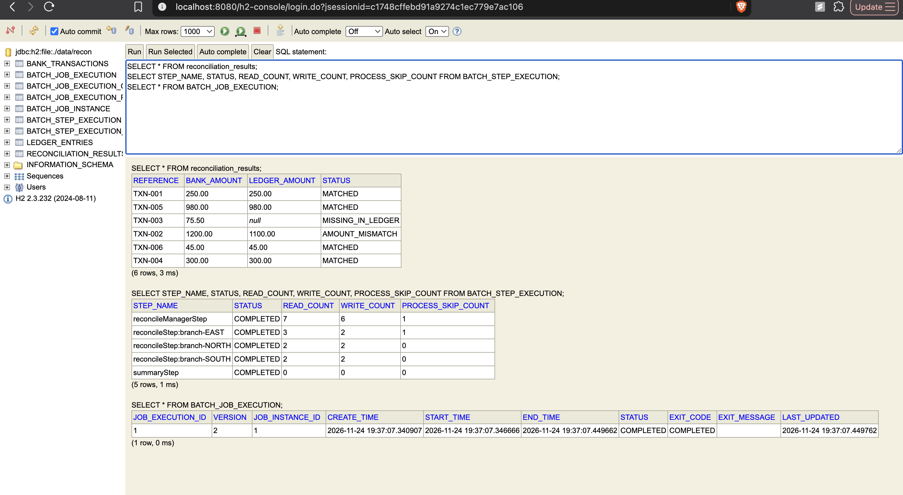

# Spring Batch: Nightly Bank Reconciliation

Companion code for the Medium article **[add article link here]**.

Every night, a bank's statement lists the transactions that actually went through. Our own system keeps a ledger of what we *think* happened. This job compares the two and records, for each transaction, one of three outcomes:

```
TXN-001   bank   250.00   ledger   250.00   -> MATCHED
TXN-002   bank 1,200.00   ledger 1,100.00   -> AMOUNT_MISMATCH
TXN-003   bank    75.50   no ledger entry   -> MISSING_IN_LEDGER
```

Java 17 · Spring Boot 3.5 · Spring Batch 5.2 · Spring Data JPA · H2 (local) / PostgreSQL (Docker)

## What the job does

```
reconciliationJob   (job parameter: businessDate)
 |
 +-- Step 1: reconcileManagerStep        partitioned: one partition per branch, in parallel
 |     +-- reconcileStep:branch-NORTH    reader -> processor -> writer, in chunks of 3
 |     +-- reconcileStep:branch-SOUTH      skip: invalid transactions (no amount)
 |     +-- reconcileStep:branch-EAST       retry: temporary database errors
 |
 +-- Step 2: summaryStep                 tasklet: count results by status
 |
 +-- ReconciliationJobListener           logs the result, the place for alerts
```

## Run it locally (H2)

Requires Java 17+ and Maven.

```bash
mvn spring-boot:run
```

The job does **not** run at startup. Launch it for the sample date:

```bash
curl -X POST "http://localhost:8080/jobs/reconcile?businessDate=2026-11-24"
```

The log ends with:

```
Skipped TXN-007: No amount for TXN-007
AMOUNT_MISMATCH: 1
MATCHED: 4
MISSING_IN_LEDGER: 1
Reconciliation finished: COMPLETED
```

Look at the data in the H2 console at http://localhost:8080/h2-console (JDBC URL `jdbc:h2:file:./data/recon`, user `sa`, no password):

```sql
SELECT * FROM reconciliation_results;
SELECT STEP_NAME, STATUS, READ_COUNT, WRITE_COUNT, PROCESS_SKIP_COUNT FROM BATCH_STEP_EXECUTION;   -- one row per partition
SELECT * FROM BATCH_JOB_EXECUTION;
```

After one run, the H2 console shows the reconciliation results (TXN-007 is absent because it was skipped), one step execution per branch partition (EAST read 3 rows, wrote 2 and skipped 1), and the completed job execution:



Run the same request again and you get `409 Conflict`: 24 November is already reconciled.

## Run it with Docker (PostgreSQL)

```bash
docker compose up --build
curl -X POST "http://localhost:8080/jobs/reconcile?businessDate=2026-11-24"
```

The `docker` profile switches the app to PostgreSQL. Job metadata is kept in a Docker volume, so it survives restarts. To start from scratch: `docker compose down -v`.

## Try a restart

1. In `ReconciliationProcessor.process()`, add a temporary failure:
   ```java
   if (txn.getReference().equals("TXN-005")) {
       throw new IllegalStateException("Ledger service unavailable");
   }
   ```
2. Delete the old data (`rm -rf data/`), start the app, and launch the job. NORTH and SOUTH complete; EAST fails; the job ends `FAILED`.
3. Remove the line, restart the app, and send the same request. Only the EAST partition runs again, from where it stopped.

## Scheduling

`ReconciliationScheduler` launches the job every night at 01:30 India time, for yesterday's date:

```properties
reconciliation.cron=0 30 1 * * *      # second minute hour day month weekday
reconciliation.zone=Asia/Kolkata
```

If an external scheduler (such as a Kubernetes CronJob) starts the job instead, set `reconciliation.scheduler.enabled=false`. With several app instances, either use a lock (e.g. ShedLock) or schedule outside the app, otherwise every instance runs the job.

## Tests

```bash
mvn test
```

- `ReconciliationProcessorTest` tests the business logic as plain Java, with a mocked repository.
- `ReconciliationJobTest` runs the whole job against an in-memory database and checks the results, the skip count and the three partitions.

## Project layout

```
src/main/java/com/example/reconciliation
 ├── ReconciliationApplication.java       @SpringBootApplication + @EnableScheduling
 ├── domain/                              JPA entities: BankTransaction, LedgerEntry, ReconciliationResult
 ├── repository/                          Spring Data repositories
 ├── batch/
 │    ├── ReconciliationJobConfig.java    job, steps, reader, writer, partitioner
 │    ├── ReconciliationProcessor.java    the business logic
 │    ├── SummaryTasklet.java             step 2
 │    ├── ReconciliationSkipListener.java
 │    ├── ReconciliationJobListener.java
 │    └── InvalidTransactionException.java
 └── launch/
      ├── ReconciliationScheduler.java    cron trigger
      └── ReconciliationController.java   manual trigger: POST /jobs/reconcile
src/main/resources
 ├── application.properties               H2, chunk size, threads, cron
 ├── application-docker.properties        PostgreSQL
 ├── schema.sql                           business tables
 └── data-h2.sql / data-postgresql.sql    sample data
```

## Settings worth knowing

| Property | Default | Meaning |
| --- | --- | --- |
| `batch.chunk-size` | `3` | Items per chunk and reader page size. 3 for the demo; start around 1000 in production. |
| `batch.partition-threads` | `4` | Threads for the branch partitions. Keep below the DB connection pool size. |
| `spring.batch.job.enabled` | `false` | The job runs only when the scheduler or the endpoint launches it. |
| `spring.batch.jdbc.initialize-schema` | `always` | Creates the `BATCH_*` tables. In production, prefer Flyway or Liquibase. |
| `reconciliation.scheduler.enabled` | `true` | Turn off the in-app cron trigger. |
